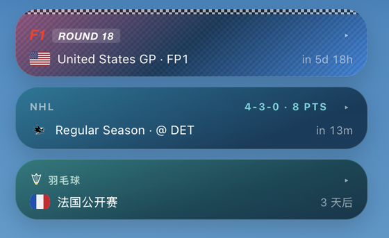
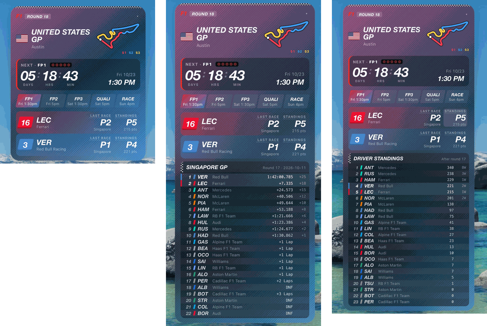
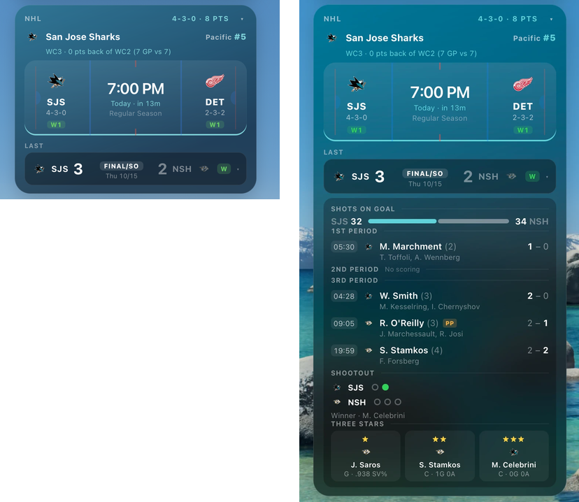
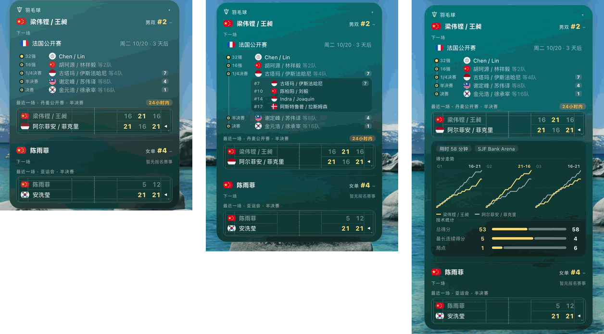

# Sports Tracker Widget

[中文说明](README.zh-CN.md)

A compact macOS desktop widget ([Übersicht](https://tracesof.net/uebersicht/)) that tracks the
athletes and teams you follow: F1 drivers, an NHL team and BWF badminton players.

- **F1**: next session countdown, full weekend schedule, circuit map split into S1/S2/S3,
  per-driver last race result, championship position and this weekend's session results.
- **NHL**: next game (Apple Sports style matchup with records and last-10 form), last result,
  division rank and playoff picture (wild-card position, points from the cut line).
- **Badminton**: world ranking with weekly ▲▼ change, last match scoreboard, next match or
  next tournament entered, and the knockout path with every possible opponent per round
  (click "等N队" / "+N" to expand).
- Events that started within the last 24 h are highlighted; sports with nothing happening
  soon collapse to one line. The widget can be dragged anywhere.

The data layer and display layer are separate: `fetch.py` writes one generic `data.json`
that any client can read (the Übersicht widget now, an iOS Scriptable widget later).

## Screenshots

**Collapsed view.** A sport with nothing live, nothing in the next 48 h and nothing finished in
the last 24 h folds into one line (next event + countdown). Click ▸ to expand; drag any card
header to move the widget.



**F1.** Racing-style card in the two drivers' team colours: round number, circuit map split
into S1/S2/S3, countdown with start lights (one more lights up each day; "LIGHTS OUT" when the
session is live), the weekend's sessions, and a row per driver. Click **LAST RACE** for the full
classification (lapped cars as "+N Lap") or **STANDINGS** for the driver table — your drivers
are highlighted.



**NHL.** Next game on an ice-sheet matchup with records and streaks, the playoff picture under
the team name, and the last game as a scoreboard. Click the scoreboard for shots on goal, every
goal by period (scorer, assists, PP/SH/EN, running score), the shootout and the three stars.
During a game the matchup turns into a live score with period and clock, updated every minute.



**Badminton** (shown in Chinese). Court-green card: world ranking with weekly change, the next
tournament with the draw path as a timeline — click "等N队" to list every possible opponent with
their world ranking — and the last match on a court board. Click the board for duration, venue,
a rally-by-rally score progression chart for each game, and match stats.



## Requirements

- macOS with Python 3.9+ (the system `python3` is fine)
- [Übersicht](https://tracesof.net/uebersicht/)

## Setup

```bash
git clone git@github.com:Caranthir-Xu/sports-tracker-widget.git
cd sports-tracker-widget
python3 -m venv .venv
.venv/bin/pip install -r requirements.txt
.venv/bin/python fetch.py          # test run, writes ./data.json
./launchd/install.sh               # deploy and run every 30 minutes
```

Then open Übersicht → Preferences → **Widgets Folder** and choose this repo's `widget/` folder.

`install.sh` copies the data layer to `~/Library/Application Support/sports-tracker/`,
because macOS privacy rules stop launchd jobs from reading `~/Documents`. Re-run it after
changing `fetch.py`, `providers/` or `config.yaml`. `./launchd/install.sh remove` uninstalls.

## iOS widget (Scriptable)

`ios/` holds an iPhone version for [Scriptable](https://scriptable.app). It fetches the data
on the phone itself (a JavaScript port of the data layer, same `data.json` schema), so it
works without the Mac. Sizes: small (next event), medium (one sport), large (all sports)
and lock screen; tapping a widget opens an interactive detail page.

1. Install Scriptable, open it once and enable it under iCloud Drive.
2. On the Mac run `./ios/install.sh` (copies `Sports Data.js` and `Sports Tracker.js` into
   Scriptable's iCloud folder), or copy both files into Scriptable by hand.
3. Add a Scriptable widget, choose script **Sports Tracker**, and optionally set the
   parameter to `f1`, `nhl` or `badminton` (empty = whatever is coming up next).

Edit `CONFIG` at the top of `Sports Tracker.js` to change who you follow.

## Configuration

Edit `config.yaml` to choose who to follow, the timezone and extra output paths
(optional `extra_outputs`). Each sport has a provider in `providers/`
with the same interface: `fetch_subject(subject) -> {ranking, next, last, profile}`.
If one source fails, that subject keeps its last good data and is marked stale.

Chinese names for badminton players live in `providers/badminton_names_zh.yaml`.

## Data sources

All free, no API keys. Most are unofficial and may change without notice.

| Sport | Source |
|---|---|
| F1 | [OpenF1](https://openf1.org) (schedule, results), [Jolpica](https://github.com/jolpica/jolpica-f1) (standings), MultiViewer (circuit outlines) |
| NHL | `api-web.nhle.com` (unofficial NHL API) |
| Badminton | BWF website's internal API (behind Cloudflare; requested via `curl_cffi`) |

See [CLAUDE.md](CLAUDE.md) for the `data.json` schema, endpoint details and gotchas.

For personal use. Not affiliated with Formula 1, the NHL or the BWF.
